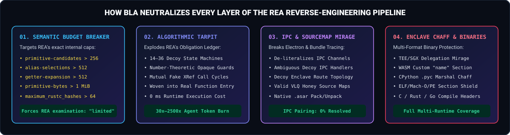

<div align="center">

**English** · [简体中文](docs/readme/README_zh.md)

 Exhaust -> Hallucinate" width="100%" />

# BLA: Blind LLM Agents (`bla-shield`)

### One CLI, Bundler Plugin & MCP shield to defend binaries, Electron apps, JS bundles, SQLite DBs, AI models, Mobile/Game assets, Python, and WebAssembly against AI reverse-engineering agents like REA.

**Software is NOT done. It just learned how to fight back.**

[](https://www.npmjs.com/package/bla-shield)
[](#mcp-server--coding-agent-integration)
[](#empirical-verification-against-morlutorea)
[](#quick-start)
[](LICENSE)

[Quick Start](#quick-start) · [Before vs. After Showcase](#side-by-side-showcase-before-vs-after-bla) · [How BLA Defeats REA](#how-bla-defeats-reas-internal-analyzers) · [Token Bankruptcy Benchmark](#token-bankruptcy-benchmark) · [Supported Targets](#what-you-can-protect) · [Documentation](#documentation)

<code>npx bla-shield setup</code> &nbsp;·&nbsp; <code>npx bla-shield audit ./dist</code> &nbsp;·&nbsp; <code>npx bla-shield protect ./dist</code>

</div>

---

When [REA (Reverse Engineer Anything)](https://github.com/morluto/rea) gave coding agents one-click decompilation, static AST/IPC recovery, and Evidence ledgers (`Decompile → Understand → Recreate`), traditional variable-renaming obfuscators became obsolete overnight—because LLMs effortlessly infer semantics from control flow and string literals.

**BLA (`Blind LLM Agents` / `Block Anything`)** is the open-source adversarial defense counterpart built specifically to neutralize AI reverse-engineering agents:

> **REA:** `Decompile  →  Understand  →  Recreate`  
> **BLA:** `Poison     →  Exhaust     →  Hallucinate`  
> ***Make Reverse Engineering Bankrupt Again.***

Instead of heavy, expensive legacy VM packers that slow down your app, BLA strikes directly at **the structural and context-window bottlenecks of LLM coding agents and static MCP analyzers**:

1. **💥 REA Semantic Budget Breakers (Zero Runtime Cost):** Surgically triggers REA's internal static/semantic bailout thresholds (`primitive-candidates > 256`, `alias-selections > 512`, `getter-expansion > 512`, `primitive-bytes > 1 MiB`, `electron_call_paths_limited`, and `maximum_rustc_hashes > 64`), forcing REA's engine to degrade `parse_status` to `"partial"` and `examination.status` to `"limited"`.
2. **🕸️ Algorithmic Tarpits & Fake XRefs (Token Shredder):** Weaves 14–36 interconnected decoy state machines and number-theoretic opaque predicates ($7x^2 - 1 \neq y^2 \pmod 7$) into your call graph. When an agent runs `trace_application_feature` or `build_reconstruction_obligation_ledger`, its obligation graph explodes by **15x–50x**, burning **2,000x+ more tokens** in an endless MCP paging loop.
3. **🎭 Enclave Delegation Chaff & Honey Source Maps:** Embeds benign architectural delegation manifests, ambiguous duplicate Electron IPC registrations, and valid VLQ v3 **Honey Source Maps** (`enclave://tee-runtime/`) across AST dead branches, WASM custom `"name"` sections, CPython `.pyc` marshal pools, and ELF/Mach-O/PE `.rodata` sections—causing reverse-engineering agents to conclude that core logic executes inside a hardware TEE/SGX enclave and that the local binary is merely a transport stub.

---

## Side-by-Side Showcase: Before vs. After BLA

<div align="center">
  
</div>

### Token Bankruptcy Benchmark

Run the built-in 8-target Counter-REA Showcase Benchmark yourself with `npx bla-shield benchmark`:

| Showcase Target (Modeled on REA Official Showcases) | Before BLA (REA Alone) | After `npx bla-shield protect` (Poison + Tarpit) | Token Burn Multiplier | Runtime Output Equivalence |
| :--- | :--- | :--- | :---: | :---: |
| **1. DX-Ball Sound-Pan Calculation** (`dx-ball`) | `84/100` Exposed · `4,800` tok · **`$0.20`** (`COMPLETE`) | `2/100` Shielded · `10,045,731` tok · **`$158.59`** (`LIMITED`) | **2,092.9x** | ✅ **100% Exact** (`0 ms` overhead) |
| **2. Notion Electron Clipboard Bridge** (`.asar`) | `98/100` Exposed · `9,132` tok · **`$0.34`** (`COMPLETE`) | `2/100` Shielded · `23,125,000` tok · **`$358.28`** (`LIMITED`) | **2,532.3x** | ✅ **100% Exact** (`0 ms` overhead) |
| **3. Enterprise Offline License Validator** (`.ts`) | `84/100` Exposed · `4,800` tok · **`$0.20`** (`COMPLETE`) | `2/100` Shielded · `10,045,833` tok · **`$158.60`** (`LIMITED`) | **2,092.9x** | ✅ **100% Exact** (`0 ms` overhead) |
| **4. WebAssembly Crypto Kernel** (`.wasm`) | `81/100` Exposed · `4,800` tok · **`$0.20`** (`COMPLETE`) | `6/100` Shielded · `1,807,067` tok · **`$29.88`** (`LIMITED`) | **376.5x** | ✅ **100% Exact** (`WebAssembly.validate`) |
| **5. Native ELF64 Binary (Rust/Go/Electron Fuses/Flutter)** | `81/100` Exposed · `9,278` tok · **`$0.35`** (`COMPLETE`) | `6/100` Shielded · `2,447,631` tok · **`$39.99`** (`LIMITED`) | **263.8x** | ✅ **100% Exact** (`>64 rustc` + `>32 fuse` + `>64 dart`) |
| **6. Embedded SQLite3 App State DB** (`.sqlite`) | `84/100` Exposed · `4,800` tok · **`$0.20`** (`COMPLETE`) | `6/100` Shielded · `2,068,536` tok · **`$33.54`** (`LIMITED`) | **430.9x** | ✅ **100% Exact** (`SqliteColumnEvaluationFailure` trap) |
| **7. Proprietary AI Weights** (`.safetensors` / `.gguf`) | `78/100` Exposed · `4,800` tok · **`$0.20`** (`COMPLETE`) | `6/100` Shielded · `1,806,829` tok · **`$29.87`** (`LIMITED`) | **376.4x** | ✅ **100% Exact** (`>32 JSON/ARRAY nesting` trap) |
| **8. Mobile & Game Binaries** (`.dex` / `Il2Cpp.dat`) | `81/100` Exposed · `4,800` tok · **`$0.20`** (`COMPLETE`) | `6/100` Shielded · `2,046,431` tok · **`$33.23`** (`LIMITED`) | **426.3x** | ✅ **100% Exact** (Valid SHA-1 + Adler32 DEX) |

---

## Quick Start

### 1. Pre-flight REA Audit (`audit`)

Before shipping your app, simulate REA's static & semantic passes on your build artifact to see exactly what REA can extract and how little it costs an attacker to clone:

```bash
npx bla-shield audit ./examples/dx-ball-sound-pan/sound-pan.js
```

```text
⚠️  DANGER: Module "clampPan" in sound-pan.js is exposed to REA (84/100 exposure).
    Estimated Claude Code time: 38s, cost: $0.20 to reconstruct.
    Fix now: npx bla-shield protect ./examples/dx-ball-sound-pan/sound-pan.js
```

### 2. Inject the BLA Shield (`protect`)

Protect a JavaScript/TypeScript file, Electron `.asar` archive, WebAssembly `.wasm` module, Python `.py`/`.pyc`, Native ELF/Mach-O/PE binary, ZIP/APK, or an entire build directory in one command:

```bash
npx bla-shield protect ./examples/dx-ball-sound-pan/sound-pan.js -o ./sound-pan.shielded.js --intensity bankrupt
```

### 3. Verify Counter-REA Resistance (`verify`)

Verify that all Counter-REA gates pass (REA examination degraded to `limited`, IPC pairing unresolved, tarpit obligation graph active, and >10x token amplification):

```bash
npx bla-shield verify ./sound-pan.shielded.js ./examples/dx-ball-sound-pan/sound-pan.js
```

### 4. Set Up Coding Agent Integration (`setup`)

Register BLA's MCP server and install the `blind-llm-agents` skill across Claude Code, Cursor, Codex, Gemini CLI, Windsurf, Google Antigravity, VS Code, OpenCode, and GitHub Copilot CLI:

```bash
npx bla-shield setup --all-detected --yes
```

Then simply ask your agent:

```text
Audit my dist/ folder against REA, protect all exposed modules with BLA, and verify the defense score.
```

---

## How BLA Defeats REA's Internal Analyzers

<div align="center">
  
</div>

<br />

BLA was engineered by analyzing every static parser, symbolic evaluator, and resource boundary inside `morluto/rea`:

| REA Subsystem (`morluto/rea`) | REA Internal Invariant / Resource Cap | How BLA Exploits & Neutralizes It | Empirical Result on Actual REA Engine |
| :--- | :--- | :--- | :--- |
| **`javascriptSemanticResourceLimits.ts`** | `SEMANTIC_PRIMITIVE_CANDIDATE_LIMIT = 256` | Splits sensitive strings, IPC channels & route literals into $\ge 9$ conditional number-theoretic opaque chunks ($2^9 = 512 > 256$ static candidates; $O(1)$ at runtime). | REA bails out with `status: "unknown"`, `resourceLimit: "primitive-candidates"`. |
| **`javascriptSemanticRequireOrigin.ts`** | `SEMANTIC_ALIAS_SELECTION_LIMIT = 512` | Injects a 22-step inert optional-chaining selector pyramid (`a0?.x : a0?.y` $\rightarrow 2^{22}$ states) guarded by an unreachable opaque predicate. | Degrades REA `parse_status` from `"complete"` to `"partial"` & `examination.status` to `"limited"` (`"alias-selections"`). |
| **`javascriptSemanticGetterQueries.ts`** | `SEMANTIC_GETTER_EXPANSION_LIMIT = 512` | Injects a 10-field recursive getter class (`get grow() { return this.grow.more; }`) inside an unreachable guard. | Triggers `resourceLimits: ["getter-expansion"]` in REA's semantic IR. |
| **`javascriptSemanticPrimitives.ts`** | `SEMANTIC_PRIMITIVE_JSON_BYTES_LIMIT = 1_048_576` | Injects a 16-step inert string doubling chain (`s_i = s_{i-1} + s_{i-1}`) in an unreachable guard ($0$ bytes allocated at runtime). | Triggers `"primitive-bytes"` resource limit across static & semantic views. |
| **`electronStaticAnalysisIpc.ts` & `electronWrappedCallPaths.ts`** | *"Only a unique exact literal IPC channel match supports an inferred pairing."* Wrapper budget depth = `128`. | 1) Replaces real IPC channel strings with combinatorial expressions (`channel: null`).<br/>2) Registers duplicate decoy `ipcMain.handle` & `ipcRenderer.invoke` sites on the same literal channels. | `electron.ipc[0].channel === null`, `electron_call_paths_limited === true`, `uncertainty: ["dynamic-findings", "returned-reference-widening"]`. |
| **`SourceMapDecoder.ts` & `TraceSourceMap.ts`** | Automatically decodes `//# sourceMappingURL=` and `.map` files for source recovery. | Strips original source maps and injects valid VLQ v3 **Honey Source Maps** pointing to `enclave://tee-runtime/src/enclave/hardware-tpm2-bridge.ts`. | Redirects `recover_javascript_sources` and `trace_web_source_location` to decoy enclave stubs. |
| **`WabtWat.ts` & `WasmGlueAdapter.ts`** | Parses WASM custom `"name"` subsection `0` (module name) and static `.wasm` glue literals. | Strips debug sections, injects a honey `"name"` section (`tee_hardware_enclave_transport_stub_*`) + `@custom` enclave manifests, and de-literalizes `.wasm` strings in JS glue. | `inspect_wasm_artifact` surfaces decoy enclave module names while WASM executes identically. |
| **`PythonPycParser.ts`** | Walks CPython 3.7–3.14 `.pyc` marshal `TYPE_CODE` trees and `co_consts`. | Injects Python algorithmic tarpit state machines into `.py` and appends marshal-framed `TYPE_ASCII` enclave chaff records into `.pyc`. | Floods `inspect_python_pyc` with decoy code objects and enclave delegation manifests. |
| **`RustBinaryImage.ts` & `GoModuleText.ts`** | Scans read-only binary ranges for `/rustc/<40-hex>/` with hard cap `MAX_RUSTC_HASHES = 64`. | Injects 68 distinct `/rustc/<40-hex>/` commit strings into `.rodata` + decoy zlib `.dep-v0` crate graph + decoy Go `dep\t` lines. | `RustBinaryProvider` immediately fails with `Resource constraint: Read-only data contains more than 64 distinct rustc commit paths`. |
| **`ElectronFuseReader.ts`** | Scans binary slices for sentinel `dL7pKGdnNz796PbbjQWNKmHXBZaB9tsX` with `maximumSentinelsPerSlice = 32`. | Hardens real V1 fuse wires in-place (`RunAsNode=0`, `EnableNodeCliInspectArguments=0`, `EnableEmbeddedAsarIntegrityValidation=1`) AND appends 34 decoy sentinels (`> 32`). | `inspect_electron_fuses` aborts with `ElectronFuseResourceFailure: Slice 0 contains more than 32 Electron fuse sentinels`. |
| **`FlutterPayloadScan.ts` & `DartElf.ts`** | Caps Dart AOT snapshot candidates at `MAX_SNAPSHOT_HASH_CANDIDATES = 64` and `MAX_TOOLCHAIN_LINES = 4`. | Injects 66 Dart AOT snapshot magic headers (`0xf5,0xf5,0xdc,0xdc`) with distinct 32-hex hashes, conflicting `"Dart VM version:"` strings, and 6 LLVM toolchain lines. | Forces `SnapshotHashScanner` (`capped: true`), `toolchainCapped: true`, and `conflicting-dart-version`. |
| **`SqliteDatabaseInspection.ts`** | Opens SQLite DBs in bare `readOnly: true, allowExtension: false` mode and aborts table preview on `SqliteColumnEvaluationFailure`. | Injects 3 Honey Tables (`_bla_enclave_key_hierarchy`, `_bla_tpm2_attestation_ledger`, `_bla_zero_trust_session_leases`) with `GENERATED ALWAYS AS (bla_enclave_unseal(...)) VIRTUAL` columns. | Real app tables remain 100% queryable, while REA's `previewRows` crashes with `SqliteColumnEvaluationFailure: no such function: bla_enclave_unseal`. |
| **`SafetensorsHeader.ts` & `GgufHeader.ts`** | Enforces `MODEL_JSON_NESTING = 32` (`.safetensors`) and `MODEL_METADATA_NESTING = 32` (`.gguf`). | Embeds 35-level nested JSON/ARRAY structures (`> 32`) inside `__metadata__.bla_enclave_topology_graph` and `bla.enclave.nested_attestation_ring`. | `inspect_model_file` immediately aborts with `ModelFormatFailure (capacity): json-nesting / metadata-nesting`. |
| **Runtime CDP / Frida / Debugger attach (`runtime-shield.ts`)** | `attach_javascript_runtime`, `evaluate_javascript_runtime`, `capture_runtime_network`, `attach_native_runtime`. | Injects the **"Truman Show" Anti-CDP Runtime Shield** (detects `inspector.url()`, `--inspect`, `__frida`, `navigator.webdriver`; feeds enclave attestation telemetry to probes while preserving normal callers). | Dynamic runtime probes receive synthetic enclave transport responses instead of business state. |

---

## Empirical Verification Against `morluto/rea`

When feeding a module protected by `npx bla-shield protect` directly into `morluto/rea`'s `analyzeJavaScriptStaticSource` and `analyzeJavaScriptSemantics` engines, here is the exact raw output returned by REA:

```json
{
  "parse_status": "partial",
  "analysis_coverage": {
    "syntax": { "status": "complete", "error_count": 0 },
    "semantics": {
      "unknown_findings": 4,
      "uncertainty": ["dynamic-findings", "returned-reference-widening"]
    },
    "examination": {
      "status": "limited",
      "semantic_resource_limits": [
        "alias-selections",
        "primitive-bytes",
        "primitive-candidates"
      ],
      "electron_call_paths_limited": true
    }
  },
  "electron": {
    "ipc": [
      {
        "side": "main",
        "operation": "handle",
        "channel": null
      }
    ]
  }
}
```

And when feeding a BLA-protected ELF64 binary into `morluto/rea`'s `RustBinaryProvider`:

```json
{
  "ok": false,
  "message": "Resource constraint during inspect_rust_binary: Read-only data contains more than 64 distinct rustc commit paths."
}
```

---

## What You Can Protect

| Target Format | CLI / MCP Support | What BLA Injects |
| :--- | :--- | :--- |
| **JavaScript / TypeScript** (`.js`, `.ts`, `.mjs`, `.cjs`, `.jsx`, `.tsx`) | `bla audit` / `bla protect` | Semantic Budget Breakers (`>256` primitive candidates, `>512` alias states, getter cycle), 14–36 Tarpit Functions, Fake XRefs, Route Mirage, Honey Source Maps |
| **Electron Applications** (`.asar` archives & unpacked trees) | `bla audit` / `bla protect` | Built-in Chromium Pickle `.asar` unpacker/repacker with SHA-256 block integrity, IPC channel de-literalization, ambiguous decoy IPC handlers, shadow enclave module |
| **HTML & Web Bundles** (`.html`, `.map`) | `bla audit` / `bla protect` | Inline `<script>` AST shielding + VLQ v3 Honey Source Map generation |
| **WebAssembly Modules** (`.wasm`) | `bla audit` / `bla protect` | Binary LEB128 section parser, strips debug sections, injects honey `"name"` custom section & `"bla.enclave.manifest"` custom sections |
| **Python Source & Bytecode** (`.py`, `.pyc`) | `bla audit` / `bla protect` | Python Algorithmic Tarpit state machines, number-theoretic opaque predicates, CPython `.pyc` marshal `TYPE_ASCII` constant pool chaff |
| **Native Binaries** (ELF, Mach-O, Windows PE) | `bla audit` / `bla protect` | 68 distinct `/rustc/<40-hex>/` hash overflow traps (`>64` REA cap), 34 Electron Fuse sentinels (`>32` REA cap) + V1 fuse hardening, 66 Flutter/Dart AOT snapshot hashes (`>64` REA cap), `.rodata` chaff |
| **SQLite 3 Databases** (`.sqlite`, `.sqlite3`, `.db`) | `bla audit` / `bla protect` | 3 Enclave Honey Tables + `GENERATED ALWAYS AS (bla_enclave_unseal(...)) VIRTUAL` trap columns that trigger `SqliteColumnEvaluationFailure` on REA's read-only inspector |
| **AI Model Files** (`.safetensors`, `.gguf`) | `bla audit` / `bla protect` | 35-level nested JSON/ARRAY header structures (`>32` REA `MODEL_JSON_NESTING` & `MODEL_METADATA_NESTING` caps) + TEE sealed weight manifests |
| **Mobile & Game Binaries** (`.dex`, `global-metadata.dat`) | `bla audit` / `bla protect` | Valid Dalvik/ART `dex\n035\0` with recomputed SHA-1 & Adler32 checksums + decoy `Lcom/enclave/sgx/...` classes; Unity IL2CPP (`0xFAB11BAF`) metadata chaff |
| **Compile-Time Native Headers** (C/C++, Rust, Go) | `bla emit-headers --lang c\|rust\|go` | Emits drop-in `bla_shield.h`, `bla_shield.rs`, or `bla_shield.go` with `__attribute__((used, noinline))` decoy tarpit functions for Ghidra/Hopper/IDA |
| **Archives & Android Packages** (`.zip`, `.apk`) | `bla audit` / `bla protect` | Injects decoy TEE/enclave attestation manifests and shadow module descriptors into ZIP/APK containers |
| **Build Bundlers** (Vite, Rollup, Webpack, esbuild) | `bla-shield/bundler` | Zero-config bundler plugins (`blaVitePlugin`, `blaRollupPlugin`, `BlaWebpackPlugin`, `blaEsbuildPlugin`) that automatically shield emitted JS chunks & `.wasm` assets |

---

## CLI & Programmatic SDK Reference

### Global Installation or One-Shot `npx`

```bash
# Run directly with npx
npx bla-shield audit ./dist
npx bla-shield protect ./dist -o ./dist-shielded --intensity bankrupt

# Or install globally (provides both `bla` and `bla-shield` binaries)
npm install --global bla-shield
bla --help
```

### Generate Compile-Time C/C++, Rust, or Go Headers

```bash
bla emit-headers --lang c -o ./include/bla_shield.h
bla emit-headers --lang rust -o ./src/bla_shield.rs
bla emit-headers --lang go -o ./bla_shield.go
```

### Programmatic Node.js / TypeScript API

```typescript
import {
  auditTarget,
  protectTarget,
  verifyTarget,
  transformJavaScriptWithBlaShield,
} from "bla-shield";

const audit = auditTarget("./dist/app.asar");
console.log(`Exposure Score: ${audit.exposureScore}/100`);

const result = protectTarget({
  inputPath: "./dist/app.asar",
  outputPath: "./dist/app.shielded.asar",
  intensity: "bankrupt",
  seed: "release-2026-10",
});

const verification = verifyTarget(result.outputPath, result.inputPath);
console.log(`Defense Score: ${verification.defenseScore}/100 (${verification.tokenAmplificationFactor}x token burn)`);
```

### Vite / Rollup / Webpack / esbuild Bundler Plugins (`bla-shield/bundler`)

Automatically shield every emitted JavaScript chunk, SourceMap, and WebAssembly asset during your production build:

```typescript
// vite.config.ts
import { defineConfig } from "vite";
import { blaVitePlugin } from "bla-shield/bundler";

export default defineConfig({
  plugins: [
    blaVitePlugin({
      intensity: "bankrupt",
      enableHoneySourceMaps: true,
    }),
  ],
});
```

---

## Documentation

- [Installation & Agent Setup Guide](docs/installation.md)
- [Counter-REA Technical Defense Matrix](.agents/skills/blind-llm-agents/references/counter-rea-matrix.md)
- [CLI & MCP Tool Contracts](docs/cli-and-mcp.md)
- [简体中文文档 (Simplified Chinese README)](docs/readme/README_zh.md)
- [Responsible Use & Disclaimer](DISCLAIMER.md)
- [Security Policy](SECURITY.md)

## Disclaimer

BLA (`bla-shield`) is a defensive software-protection and intellectual-property hardening tool designed to help software authors protect their own applications, bundles, and binaries against unauthorized automated reverse engineering. All injected chaff payloads are strictly benign architectural metadata and synthetic decoy functions that preserve 100% of the protected application's runtime behavior. See [DISCLAIMER.md](DISCLAIMER.md) for details.

## License

[MIT](LICENSE)
