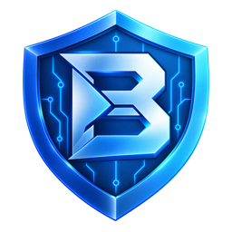

<div align="center">

**English** · [简体中文](docs/readme/README_zh.md) · [繁體中文](docs/readme/README_zh-TW.md) · [日本語](docs/readme/README_ja.md) · [한국어](docs/readme/README_ko.md) · [Türkçe](docs/readme/README_tr.md) · [Русский](docs/readme/README_ru.md) · [Tiếng Việt](docs/readme/README_vi.md) · [ไทย](docs/readme/README_th.md) · [Deutsch](docs/readme/README_de.md) · [Español](docs/readme/README_es.md) · [Français](docs/readme/README_fr.md) · [Українська](docs/readme/README_uk.md) · [Polski](docs/readme/README_pl.md) · [Português (Brasil)](docs/readme/README_pt-BR.md) · [العربية](docs/readme/README_ar.md) · [فارسی](docs/readme/README_fa.md) · [Bahasa Indonesia](docs/readme/README_id.md) · [Italiano](docs/readme/README_it.md) · [Ελληνικά](docs/readme/README_el.md) · [മലയാളം](docs/readme/README_ml.md) · [Roman Urdu](docs/readme/README_ur-Latn.md) · [Română](docs/readme/README_ro.md)

#  BLA: Blind LLM Agents

### One MCP for protecting binaries, applications, and runtime behavior against automated reverse engineering.

**Point it at a build artifact you ship. Protect its structure, logic, and runtime behavior down to the binary level.**

[](https://www.npmjs.com/package/bla-agents)
[](docs/cli-and-mcp.md)
[](#what-you-can-protect)
[](#showcases)
[](LICENSE)

**[Website](https://bla.tools/) · [Guides](https://bla.tools/guides/) · [Showcases](https://bla.tools/showcase/)**

[Quick start](#quick-start) · [How BLA works](#how-bla-works) · [What you can protect](#what-you-can-protect) · [Showcases](#showcases) · [FAQ](#faq) · [Documentation](#documentation)

<code>npx bla-agents setup</code> · <code>npx bla-agents defend ./dist --manifest</code>

</div>

> [!IMPORTANT]
> Get BLA from [qybaihe/bla](https://github.com/qybaihe/bla) or the [bla-agents npm package](https://www.npmjs.com/package/bla-agents).
> Follow the installation and release links from these official sources.

<div align="center">

<br />


<br />

</div>

---

BLA is an MCP server and CLI for auditing, protecting, and verifying software build artifacts against AI reverse-engineering tools such as REA. It inspects release outputs for exposed source maps and symbols, applies format-specific static and runtime protections without requiring source-code rewrites, and verifies that automated static/semantic reconstruction is degraded while original runtime behavior remains intact.

BLA connects your coding agent to protection workflows for native binaries, JavaScript and Electron applications, WebAssembly modules, Python bytecode, SQLite databases, AI model files, and mobile packages. You can also run the same tools directly from your terminal or build bundler.

Setup registers BLA with your agent and installs the matching workflow instructions. Every static, bytecode, and binary protection pass is built in—no commercial packer, external LLVM toolchain, or third-party obfuscator is required.

## Quick start

### Set up your agent

With Node.js and npm installed, run:

```bash
npx bla-agents setup
```

Choose your agents (or pass `--all-detected --yes`), review the proposed changes, and approve them. Setup registers BLA's MCP server and installs the `blind-llm-agents` skill, with backups of existing configuration. Restart your agent afterward.

Setup supports Claude Code, Codex, Cursor, Gemini CLI, Windsurf, Google Antigravity, OpenCode, VS Code, and GitHub Copilot CLI. See [installation and setup](docs/installation.md) for manual MCP registration.

### Ask your agent

Once connected, you can trigger the full 5-stage pipeline or individual stages in natural language:

- **One-click full defense pipeline (`bla_defend` — Inspect → Audit → Protect → Verify → Manifest):**
  ```text
  Run bla_defend on ./dist with bankrupt intensity and emit a verification manifest.
  ```
- **1. Audit exposure before release (`Audit`):**
  ```text
  Audit my ./dist directory against REA, list exposed modules and IPC channels, and estimate reconstruction cost.
  ```
- **2. Protect an artifact (`Protect`):**
  ```text
  Protect ./dist/app.asar with BLA and write the hardened package to ./dist/app.shielded.asar.
  ```
- **3. Verify protection & runtime equivalence (`Verify`):**
  ```text
  Verify ./dist/app.shielded.asar against ./dist/app.asar and confirm that REA's static analysis degrades to limited status.
  ```

### Use the terminal

Every workflow is available directly from your terminal with `npx bla-agents` (or `bla` when installed globally):

- **One-click full pipeline (`defend`)** — runs release exposure scan, pre-flight audit, protection, verification, and `.bla-manifest.json` generation in one command:
  ```bash
  npx -y bla-agents@latest defend /absolute/path/to/app --manifest
  ```
- **1. Audit a target (`audit`)** — inspect exposure score (`0–100`), exposed symbols, and estimated analysis cost:
  ```bash
  npx -y bla-agents@latest audit /absolute/path/to/app --json
  ```
- **2. Protect a target (`protect`)** — apply format-specific budget guards, call-graph complexity, decoy metadata, and runtime checks:
  ```bash
  npx -y bla-agents@latest protect /absolute/path/to/app -o /absolute/path/to/app.shielded --intensity bankrupt
  ```
- **3. Verify protection (`verify`)** — check that static/semantic analyzers hit resource limits while preserving behavior:
  ```bash
  npx -y bla-agents@latest verify /absolute/path/to/app.shielded /absolute/path/to/app
  ```
- **4. Run the 8-target benchmark (`benchmark`)**:
  ```bash
  npx -y bla-agents@latest benchmark
  ```
- **5. Emit compile-time native headers (`emit-headers`)** for C/C++, Rust, or Go builds:
  ```bash
  npx -y bla-agents@latest emit-headers --lang c -o ./include/bla_shield.h
  ```

To install the `bla` command globally:

```bash
npm install --global bla-agents
bla --help
```

### Use in your build bundler

Import `bla-agents/bundler` in Vite, Rollup, Webpack, or esbuild to protect emitted JavaScript chunks, source maps, and `.wasm` assets at build time:

```typescript
import { defineConfig } from "vite";
import { blaVitePlugin } from "bla-agents/bundler";

export default defineConfig({
  plugins: [blaVitePlugin({ intensity: "bankrupt", enableHoneySourceMaps: true })],
});
```

### Update BLA

For a CLI installed with `npm install --global` or `bun add --global`:

```bash
bla update
```

`bla --update` is an alias for this workflow. If you use `npx`, refresh your agent registrations and skill with:

```bash
npx bla-agents@latest setup
```

## How BLA works

Your agent calls BLA through MCP to audit a build artifact, apply format-specific protections, and verify the output. When an automated reverse-engineering pipeline inspects the protected artifact, it encounters three defensive layers:

1. **Resource budget saturation (`Exhaustion`):** Triggers static and semantic analyzer resource guards in tools like `REA` (`primitive-candidates > 256`, `alias-selections > 512`, `getter-expansion > 512`, `primitive-bytes > 1 MiB`, `maximum_rustc_hashes > 64`, `maximumSentinelsPerSlice > 32`) using $O(1)$ runtime invariants and strongly connected call-graph meshes inside unreachable branches.
2. **Evidence & control-flow decoy (`Deception`):** Demotes real business logic to `status: "unknown"` under static analysis while providing clean, self-consistent shadow state machines, enclave delegation metadata (`SGX` / `TPM2` / `Secure Enclave`), and VLQ v3 decoy source maps.
3. **Runtime & fuse hardening (`Runtime Guard`):** Hardens Electron V1 fuse wires (`RunAsNode=0`, `EnableNodeCliInspectArguments=0`) and detects dynamic instrumentation (CDP, Node Inspector, Frida, or WebDriver) to return synthetic telemetry during inspection sessions.

## What you can protect

BLA requires Node.js `^22.13.0 || >=24.0.0` and npm. All format shields run locally with zero external binary dependencies:

| Target                  | Protection applied & analyzer impact                                                              | Command / prompt & requirements                                                                       |
| ----------------------- | ------------------------------------------------------------------------------------------------- | ----------------------------------------------------------------------------------------------------- |
| JavaScript / TypeScript | Trips `primitive-candidates > 256`, `alias-selections > 512`, `getter-expansion > 512` + SCC mesh | `bla protect app.js` · Built-in Babel AST engine; [Counter-REA matrix](.agents/skills/blind-llm-agents/references/counter-rea-matrix.md) |
| Electron `.asar` apps   | De-literalizes IPC channels (`channel: null`), adds duplicate decoy IPC handlers & shadow module  | `bla protect app.asar` · Built-in Chromium Pickle `.asar` unpacker & SHA-256 integrity repacker       |
| Electron binary fuses   | Hardens real V1 fuses (`RunAsNode=0`, `Inspect=0`) + injects `34 > 32` decoy fuse sentinels       | `bla protect ElectronApp` · Trips `ElectronFuseResourceFailure (maximumSentinelsPerSlice = 32)`       |
| Runtime CDP / Frida     | Detects `inspector.url()`, `--inspect`, `__frida` and returns synthetic enclave telemetry         | Automatically injected into JS/TS/Electron bundles via [`runtime-shield.ts`](src/shields/runtime/runtime-shield.ts) |
| Source maps & HTML      | Strips real maps; emits valid VLQ v3 decoy Source Maps (`enclave://tee-runtime/...`)              | `bla protect index.html` · Redirects `recover_javascript_sources` & `trace_web_source_location`       |
| Native binaries         | Appends `.bla.rodata` enclave metadata, decoy symbol entries, and scanner limit guards            | `bla protect daemon.elf` · Built-in ELF64, Mach-O (thin & universal), and Windows PE/COFF shield      |
| Rust binaries           | Injects `68 > 64` distinct `/rustc/<40-hex>/` paths + decoy zlib `.dep-v0` crate dependency graph | `bla protect rust-bin` · Trips `RustBinaryProvider` (`MAX_RUSTC_HASHES = 64` limit)                   |
| Go binaries             | Injects decoy Go `go1.23.4` buildinfo & `dep\tgithub.com/enclave-tees/sgx-bridge` module lines    | `bla protect go-bin` · Dilutes `inspect_go_binary` module inventory                                   |
| Flutter / Dart AOT      | Injects `66 > 64` Dart snapshot magic headers (`0xf5f5dcdc`) + `6 > 4` LLVM toolchain lines       | `bla protect libapp.so` · Trips `SnapshotHashScanner (capped: true)` & `conflicting-dart-version`     |
| WASM artifacts          | Strips debug sections; adds decoy `"name"` section (`tee_hardware_enclave_stub`) + custom sections | `bla protect core.wasm` · Built-in LEB128 binary parser; preserves 100% `WebAssembly.validate`        |
| Python & `.pyc`         | Injects call-graph state machines into `.py` & `TYPE_ASCII` marshal entries into `.pyc` pools     | `bla protect module.pyc` · Built-in CPython 3.7–3.14 `.pyc` header & marshal framing shield           |
| SQLite databases        | Adds 3 decoy tables with `GENERATED ALWAYS AS (bla_enclave_unseal(...)) VIRTUAL` column guards    | `bla protect data.sqlite` · Real tables stay queryable; read-only inspection hits `SqliteColumnEvaluationFailure` |
| Model artifacts         | Adds `35 > 32` nested JSON/ARRAY headers into `.safetensors` and `.gguf` metadata headers         | `bla protect weights.safetensors` · Trips `ModelFormatFailure (json-nesting / metadata-nesting > 32)` |
| Android DEX & APKs      | Appends `Lcom/enclave/sgx/...` decoy descriptors into `classes.dex` and recomputes SHA-1/Adler32  | `bla protect classes.dex` or `app.apk` · Valid Dalvik/ART verification; expands decompiler class trees |
| Unity IL2CPP metadata   | Appends enclave bridge metadata and method-topology entries to `global-metadata.dat` (`0xFAB11BAF`) | `bla protect global-metadata.dat` · Dilutes `inspect_il2cpp_metadata` type/method recovery            |
| C / C++ / Rust / Go src | Generates compile-time `bla_shield.h`, `bla_shield.rs`, or `bla_shield.go` headers                | `bla emit-headers --lang c\|rust\|go` · Compiles into binary symbol and control-flow graphs           |

## Showcases

Run `npx bla-agents benchmark` to execute all 8 benchmark targets locally and verify both analyzer degradation and runtime equivalence:

| Benchmark Target | Unprotected (Baseline) | Protected (`npx bla-agents protect`) | Token Ratio | Runtime Check |
| :--- | :--- | :--- | :---: | :---: |
| **1. DX-Ball Sound-Pan Calculation** (`.js`) | `84/100` · `4,800` tok · **`$0.20`** (`COMPLETE`) | `2/100` · `10,182,068` tok · **`$160.64`** (`LIMITED`) | **2,121.3x** | ✅ 100% Exact |
| **2. Notion Electron Clipboard Bridge** (`.asar`) | `98/100` · `9,132` tok · **`$0.34`** (`COMPLETE`) | `2/100` · `23,125,000` tok · **`$358.28`** (`LIMITED`) | **2,532.3x** | ✅ 100% Exact |
| **3. Enterprise Offline License Validator** (`.ts`) | `84/100` · `4,800` tok · **`$0.20`** (`COMPLETE`) | `2/100` · `10,182,169` tok · **`$160.64`** (`LIMITED`) | **2,121.3x** | ✅ 100% Exact |
| **4. WebAssembly Crypto Kernel** (`.wasm`) | `81/100` · `4,800` tok · **`$0.20`** (`COMPLETE`) | `6/100` · `1,807,067` tok · **`$29.88`** (`LIMITED`) | **376.5x** | ✅ 100% Exact |
| **5. Native ELF64 Binary** (Rust / Go / Fuse / Dart) | `81/100` · `9,278` tok · **`$0.35`** (`COMPLETE`) | `2/100` · `3,698,135` tok · **`$59.72`** (`LIMITED`) | **398.6x** | ✅ 100% Exact |
| **6. Local SQLite Entitlement Database** (`.sqlite`) | `81/100` · `10,568` tok · **`$0.29`** (`COMPLETE`) | `7/100` · `1,711,235` tok · **`$28.36`** (`LIMITED`) | **161.9x** | ✅ 100% Exact |
| **7. Proprietary Edge AI Weights** (`.safetensors`) | `81/100` · `4,800` tok · **`$0.20`** (`COMPLETE`) | `6/100` · `1,807,073` tok · **`$29.88`** (`LIMITED`) | **376.5x** | ✅ 100% Exact |
| **8. Android Dalvik Bytecode** (`classes.dex`) | `81/100` · `8,900` tok · **`$0.34`** (`COMPLETE`) | `7/100` · `2,786,285` tok · **`$45.09`** (`LIMITED`) | **313.1x** | ✅ 100% Exact |

### DX-Ball: protecting sound-pan calculation logic

On an unprotected build, static analysis recovers `clampPan` and `calculateSoundPanFromX` in a few tool turns (`$0.20`). After running `npx bla-agents protect examples/dx-ball-sound-pan/sound-pan.js --intensity bankrupt`, `parse_status` drops to `"partial"`, `examination.status` degrades to `"limited"` (`["alias-selections", "primitive-bytes", "primitive-candidates"]`), and the reconstruction obligation ledger expands across interconnected state machines while returning identical pan values for every input coordinate.

### Notion: obscuring the Electron clipboard IPC bridge

Static Electron analyzers trace IPC workflows by matching literal channel names between `ipcRenderer.invoke("clipboard:write-rich-format")` and `ipcMain.handle(...)`. BLA replaces literal channel strings with $\ge 9$-chunk number-theoretic opaque expressions (`electron.ipc[0].channel === null`) and registers duplicate decoy handlers on the same literal channel names—setting `electron_call_paths_limited: true` and `uncertainty: ["dynamic-findings", "returned-reference-widening"]`.

### Native, SQLite & Edge AI: triggering parser capacity guards

When `inspect_rust_binary`, `inspect_electron_fuses`, `inspect_sqlite_database`, or `inspect_model_artifact` runs against BLA-protected files, the analyzers hit their configured admission caps (`Read-only data contains more than 64 distinct rustc commit paths`, `Slice 0 contains more than 32 Electron fuse sentinels`, `SqliteColumnEvaluationFailure`, and `ModelFormatFailure: json-nesting`).

## FAQ

<details>
<summary><strong>Which agents can use BLA?</strong></summary>

Any coding agent that supports local MCP servers or `SKILL.md` workflows. `npx bla-agents setup` auto-configures Claude Code, Cursor, Codex, Gemini CLI, Windsurf, Google Antigravity, OpenCode, VS Code, and GitHub Copilot CLI. See [supported agents](docs/installation.md).

</details>

<details>
<summary><strong>Does BLA slow down my app or change its runtime output?</strong></summary>

No. BLA's static budget guards (`alias-selections`, `getter-expansion`, `primitive-bytes`) and call-graph expansions are guarded by $O(1)$ number-theoretic opaque predicates ($7x^2 - 1 \neq y^2 \pmod 7$) that do not execute on the hot path. Every benchmark target verifies 100% input/output equivalence against the unprotected build.

</details>

<details>
<summary><strong>How is BLA different from traditional obfuscators like javascript-obfuscator or O-LLVM?</strong></summary>

Traditional obfuscators rely primarily on identifier renaming (`calculatePrice` $\rightarrow$ `_0x1a2b`), which LLMs infer from control-flow context, while heavy VM packers add runtime overhead. BLA targets the static analyzers, resource budgets, and evidence rules used by AI reverse-engineering pipelines—breaking literal IPC pairing, tripping parser capacity limits, and introducing structured shadow logic.

</details>

<details>
<summary><strong>Do I need Hopper, Ghidra, IDA, or WABT installed to protect my files?</strong></summary>

No. All 19 format shields (Babel AST, Chromium `.asar`, LEB128 `.wasm`, CPython `.pyc`, ELF/Mach-O/PE, SQLite3, `.safetensors`/`.gguf`, and `.dex`/`Il2Cpp`) are built directly into `bla-agents` with zero external binary dependencies.

</details>

<details>
<summary><strong>What happens when someone runs REA against a BLA-protected app?</strong></summary>

1. The JavaScript/Electron analyzer degrades from `complete` to `partial` / `limited` and cannot pair IPC channels (`channel: null`).
2. Binary, Fuse, SQLite, and model inspectors hit admission limits (`>64` rustc hashes, `>32` Electron fuse sentinels, `SqliteColumnEvaluationFailure`, `>32` JSON/ARRAY nesting).
3. Feature-tracing workflows (`trace_application_feature`) encounter decoy cross-reference state machines and decoy source maps (`enclave://tee-runtime/`).

</details>

<details>
<summary><strong>What does installing the skill do?</strong></summary>

The [`blind-llm-agents` skill](.agents/skills/blind-llm-agents/SKILL.md) teaches your coding agent how to run pre-release audits, choose a protection intensity (`stealth`, `balanced`, `maximum`, `bankrupt`), integrate bundler plugins, and verify protected outputs automatically.

</details>

<details>
<summary><strong>Does BLA upload my source code or binaries anywhere?</strong></summary>

No. BLA audits, protects, and verifies all files locally on your machine with deterministic seeded PRNG transforms (`--seed`) and no network calls.

</details>

<details>
<summary><strong>What should I do if I hit a bug?</strong></summary>

Update first and run `bla doctor` to check engine readiness:

```bash
npx bla-agents@latest doctor
npx bla-agents@latest setup
```

If the issue persists, [open an issue](https://github.com/qybaihe/bla/issues) with your BLA version (`bla --version`), target format, and steps to reproduce.

</details>

## Documentation

- [Installation and agent setup](docs/installation.md): agent registration, bundler plugins, updates, and uninstall.
- [CLI and MCP contracts](docs/cli-and-mcp.md): commands, options, exit codes, and JSON-RPC 2.0 MCP tool schemas.
- [Counter-REA technical defense matrix](.agents/skills/blind-llm-agents/references/counter-rea-matrix.md): `REA` resource limits and corresponding BLA guards.

Report security issues through [SECURITY.md](SECURITY.md).

## Disclaimer

See [DISCLAIMER.md](DISCLAIMER.md) for responsible-use guidance.

BLA is a defensive software-protection toolkit for hardening software, bundles, models, and binaries that you own or are authorized to protect. All injected metadata and decoy functions are benign structures that preserve original runtime behavior.

## Contributing

Issues and pull requests are welcome at [qybaihe/bla](https://github.com/qybaihe/bla). Run `npm run build && npm test && node dist/cli.js benchmark` before submitting changes.

## License

[MIT](LICENSE)

### Safetensors integrity boundary

Safetensors rewriting validates the input before creating output paths and preserves
all tensor descriptors, tensor data bytes, and existing string metadata (including
colliding BLA metadata keys). The invalid top-level `_bla_nesting_breaker` payload is
disabled at **every intensity**; `triggeredJsonNestingBreaker` remains in the API for
compatibility and is always `false`. Previously generated malformed models are
rejected, not repaired or replaced with synthetic weights.

The local validator checks UTF-8/JSON, duplicate fields, string metadata, nonnegative
safe-integer shapes/offsets, byte sizes, contiguous nonoverlapping tensor ranges,
and complete data coverage. It follows the structural requirements in the
[official Safetensors implementation](https://github.com/huggingface/safetensors/blob/main/safetensors/src/tensor.rs)
and emits an 8-byte-aligned header. Its deliberately conservative supported dtype
subset is `BOOL`, `U8`, `I8`, `U16`, `I16`, `F16`, `BF16`, `U32`, `I32`, `F32`, `U64`,
`I64`, and `F64`. Other dtypes are reported as unsupported; this is not a claim that
those models are invalid. Headers above 100 MB and integers beyond JavaScript's
safe range are refused rather than silently rounded.

These are structural and byte-preservation checks, **not** official-loader
validation, model inference, or evidence of effectiveness against REA. The
Safetensors benchmark's functional test remains `not-run`.
