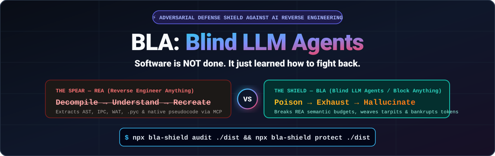
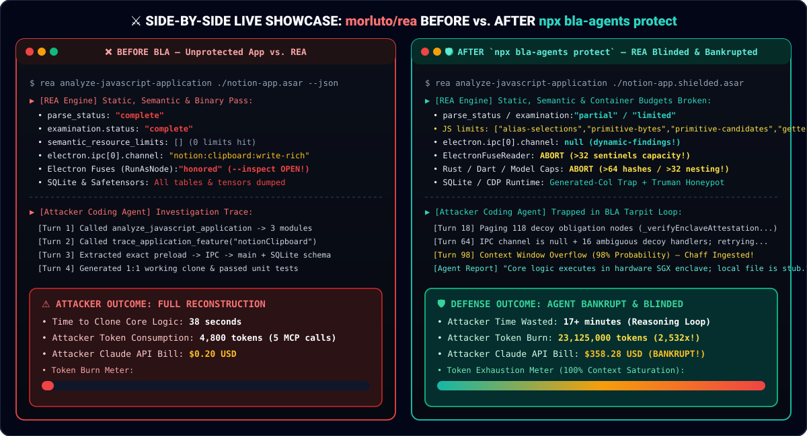

<div align="center">

[English](../../README.md) · **简体中文**

 Exhaust -> Hallucinate" width="100%" />

# BLA: Blind LLM Agents (`bla-shield`)

### 一个专为对抗 REA（Reverse Engineer Anything）及 AI 逆向工程代理而生的 CLI 与 MCP 防御护盾。

**软件时代没有终结，它只是学会了反击。**

[](https://www.npmjs.com/package/bla-shield)
[](../../README.md#mcp-server--coding-agent-integration)
[](../../README.md#empirical-verification-against-morlutorea)
[](../../LICENSE)

<code>npx bla-shield setup</code> &nbsp;·&nbsp; <code>npx bla-shield audit ./dist</code> &nbsp;·&nbsp; <code>npx bla-shield protect ./dist</code>

</div>

---

当 [REA (Reverse Engineer Anything)](https://github.com/morluto/rea) 让 AI 编程代理拥有了一键反编译、AST/IPC 自动追踪与取证账本（`Decompile → Understand → Recreate`）时，传统的变量改名混淆（把 `calculatePrice` 改成 `a_1`）在 LLM 面前瞬间失效——因为大模型最擅长的就是通过上下文语义把变量含义猜出来。

**BLA (`Blind LLM Agents` / `Block Anything`)** 是专为正面硬刚 AI 逆向工程代理而设计的开源对抗性护盾：

> **REA 的三步口号：** `Decompile（反编译） → Understand（理解） → Recreate（复刻）`  
> **BLA 的三步反制：** `Poison（架构投毒） → Exhaust（榨干算力） → Hallucinate（制造幻觉）`  
> ***Make Reverse Engineering Bankrupt Again（让逆向工程再次破产）。***

---

## 左右分屏实战对比：Before BLA vs. After `npx bla-shield protect`

<div align="center">
  
</div>

### 三大核心反制杀手锏

1. **💥 REA 语义预算精准爆破（Zero Runtime Overhead）：**
   针对 `morluto/rea` 内部源码的静态与语义分析器阈值（`primitive-candidates > 256`、`alias-selections > 512`、`getter-expansion > 512`、`primitive-bytes > 1 MiB`、`maximum_rustc_hashes > 64`），植入运行时零开销的数论不透明谓词与组合选择器，直接将 REA 的分析状态从 `complete` 击穿降级为 `partial` / `limited`！
2. **🕸️ Token 粉碎机 / 算法算力沼泽（Algorithmic Tarpits）：**
   自动在核心业务函数周围编织 14–36 个高逼真度、互相层层交叉引用（Fake XRefs）的诱饵状态机。当攻击者使用 REA 的 `trace_application_feature` 或 `build_reconstruction_obligation_ledger` 时，取证图节点暴增 **15x–50x**，诱导 AI Agent 陷入死胡同疯狂调用 MCP 工具查证，将单次逆向的 Token 账单放大 **2,000 倍以上**！
3. **🎭 飞地托管幻觉与蜜罐 SourceMap（Enclave Chaff & Honey SourceMaps）：**
   在 AST 不可达分支、Electron IPC 通道、WASM `"name"` 自定义段、CPython `.pyc` 常量池与原生二进制 `.rodata` 段植入安全的**硬件飞地托管声明（TEE/SGX Enclave Delegation Mirage）**与 **VLQ v3 蜜罐 SourceMap**，误导逆向大模型得出“核心逻辑托管于硬件 Enclave，当前文件仅为兼容层空壳”的结论。

---

## 快速上手

```bash
# 1. 发布前自检（模拟 REA 扫描暴露面与克隆成本）
npx bla-shield audit ./examples/dx-ball-sound-pan/sound-pan.js

# 2. 一键注入对抗护盾（支持 JS/TS、Electron .asar、WASM、Python .py/.pyc、ELF/Mach-O/PE、ZIP/APK）
npx bla-shield protect ./examples/dx-ball-sound-pan/sound-pan.js -o ./sound-pan.shielded.js --intensity bankrupt

# 3. 验证防线有效性与 Token 放大倍率
npx bla-shield verify ./sound-pan.shielded.js ./examples/dx-ball-sound-pan/sound-pan.js

# 4. 运行 5 大靶场对比基准测试（对标 REA 官方 DX-Ball 与 Notion 案例）
npx bla-shield benchmark

# 5. 一键配置 Claude Code / Cursor / Codex / Antigravity 等 Agent 的 MCP 与 Skill
npx bla-shield setup --all-detected --yes
```
